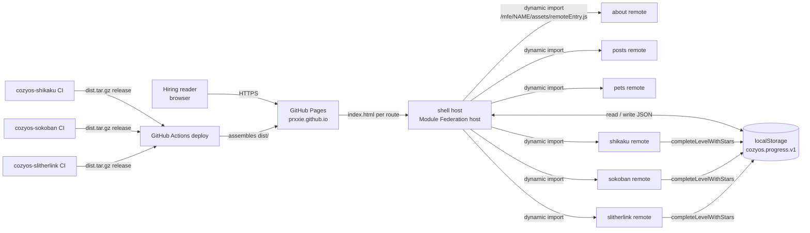

# Architecture

## Context

The system is a static artifact assembled from a monorepo and served by GitHub Pages. A browser loads one prerendered
document, which boots the shell; the shell then fetches the remote bundle for whichever region of the page needs it. No
server process exists at runtime: the only backend surfaces are the GitHub Pages host that serves bytes and GitHub
Releases that supply pre-built game bundles at build time.



| Actor / system | Direction | Contract |
|----------------|-----------|----------|
| Browser | inbound | one HTML document per route plus `/mfe/<name>/` bundles (ADR-0002) |
| GitHub Pages | outbound, read | serves the assembled `dist/` from the `gh-pages` branch (`.github/workflows/deploy.yml:48-52`) |
| Game repositories' CI | inbound at build time | a `dist.tar.gz` release asset per game, downloaded by the deploy workflow (`.github/workflows/deploy.yml:31-40`) |
| `localStorage` | read and write | the progress document, key `cozyos.progress.v1` (ADR-0004) |
| `mailto:`, LinkedIn, GitHub | outbound, user-initiated | plain links, no API (ADR-0007) |

## Components

| Component | Responsibility | Technology | Owns which data |
|-----------|----------------|------------|-----------------|
| `packages/shell` | Host application: routing, page layout, the progress context, design tokens, remote resolution | React 18.3.1, Vite 5, `@originjs/vite-plugin-federation` 1.3, Tailwind 4, Zustand 4, TanStack Query 5 | The progress document in `localStorage`; nothing server-side |
| `packages/about` | About content, exposed as `./AboutApp` | React, Vite, federation | none |
| `packages/posts` | Devlog list and post rendering, exposed as `./PostsApp` | React, Vite, federation, TanStack Query | reads markdown files; owns no state |
| `packages/pets` | Pet display, exposed as `./PetsApp`; receives the shell's progress context as a prop | React, Zustand, federation | none — display only |
| `packages/shikaku` | Shikaku puzzle remote, `./ShikakuApp`; 50 baked levels | React, Zustand, federation; `src/engine/{validation,solver,synth}.ts` | its own level progress, written through `shared` |
| `packages/sokoban` | Sokoban puzzle remote, `./SokobanApp`; 100 baked levels, BFS solver for validation | React, Zustand, federation; `src/engine/synth.ts`, `src/solver/` | as above |
| `packages/slitherlink` | Slitherlink puzzle remote, `./SlitherlinkApp`; 10 baked levels | React, Zustand, federation; `src/engine/{validation,synth}.ts`, `src/levels.ts` | as above |
| `packages/shared` | Internal library: `ProgressService`, `ProgressRepository`, `LocalProgressRepository`, evolution stages, progress types | TypeScript only, no React, no bundler config | defines the shape of the progress document |
| `scripts/build-static.sh` | Builds remotes, builds the host, assembles `dist/` with `dist/mfe/<name>/` | bash | none |
| `.github/workflows/deploy.yml` | Downloads game releases, runs the assembly, publishes to GitHub Pages | GitHub Actions | none |

Every remote declares `base: "/mfe/<name>/"` for production builds (`packages/about/vite.config.ts:8`) and exposes one
component from `remoteEntry.js`; the host maps lazily imported specifiers to
`/mfe/<name>/assets/remoteEntry.js` (`packages/shell/vite.config.ts:27-32`).

## Key flows

**1. Page load to an interactive puzzle.** The browser requests a prerendered document; the shell's markup paints. The
shell hydrates, the router resolves the route, and only the remote for that region is fetched — a game remote is not
requested until its route is opened (`packages/shell/src/App.tsx:15-56`). The router is React Router 7 in
`createStaticHandler` mode and the prerender step is a Vite SSR pass (ADR-0009). While the remote loads, `MfeLoader` renders
placeholder chrome; if the import rejects, the `catch` renders a `Fallback` naming the offline remote
(`packages/shell/src/App.tsx:58-67`) instead of an empty page.

**2. Completing a level.** The game's Zustand store detects the win condition and calls
`completeLevelWithStars(module, levelId, stars)` on the injected service. `ProgressService` forwards to the repository,
which merges the result into the progress document, keeps the best star count
(`packages/shared/src/repository/LocalProgressRepository.ts:122-147`), writes the whole document to `localStorage`, and
dispatches `cozyos:progress-updated` on `window` (`packages/shared/src/progress/service.ts:27-33`). The shell's
`ProgressServiceProvider` listens for that event and re-reads the derived values — hunger level, food available,
happiness (`packages/shell/src/hooks/useProgressService.tsx:63-81`) — which re-renders the pet widget and the level
telemetry.

**3. Feeding the pet.** The widget's feed action checks three derived conditions before writing: the pet is hungry, food
is available, and the session is not in a cooldown window
(`packages/shared/src/progress/service.ts:35-60`). Food is a star economy: `getFoodAvailable` is the sum of stars earned
minus `foodConsumed` (`packages/shared/src/progress/service.ts:93-100`), so playing puzzles is the only way to feed the
pet. A feed adds one XP, which may cross an evolution threshold (`packages/shared/src/pet/evolution.ts:1-8`).

**4. Deploy.** A push to `main`, or a `repository_dispatch` of type `mfe-updated` from a game repository, starts the
workflow: checkout with submodules, download each game's `dist.tar.gz` release into `packages/<game>/dist`, run
`pnpm`-based assembly, publish `dist/` (`scripts/build-static.sh:14-40`, `.github/workflows/deploy.yml:3-8`).

## The devlog content path

The posts live in `packages/posts/src/content/posts/*.md` and are parsed by
`packages/posts/src/content/loadPosts.ts` (frontmatter contract, `parsePost`, `sortPosts`). The
shell imports that module — and `renderPostBody` from `packages/posts/src/utils/markdown.ts` —
through the `posts/content` and `posts/markdown` aliases, so the index and the post page render
the same `Post[]`: there is no second source of truth and no fetch. The markdown is bundled as
data and compiled once; a broken post fails the build rather than the visitor.

## Cross-cutting

**Authentication.** None, by decision. The site reverted from Supabase-backed accounts to local-only progress
(ADR-0004); no login surface, no session, no token remains after the cloud adaptor is deleted.

**Error handling.** Remote imports are guarded individually so one offline MFE degrades to a named placeholder rather
than a blank frame (`packages/shell/src/App.tsx:15-67`). Service calls are wrapped in `try`/`catch` that log through
`console.error` and rethrow so callers can surface the failure
(`packages/shell/src/hooks/useProgressService.tsx:83-96`). A corrupted progress document is not fatal: the repository
falls back to a default state and recomputes the pet's stage from XP on load
(`packages/shared/src/repository/LocalProgressRepository.ts:75-92`).

**Logging.** No logging library and no event pipeline. Failures are visible in the browser console only; there is no
server-side log to correlate with (see the NFR file).

**Configuration.** Build-time `VITE_*` variables only. Today that means `VITE_SUPABASE_URL` and `VITE_SUPABASE_ANON_KEY`
(`.github/workflows/deploy.yml:44-45`); both are deleted with the backend (ADR-0004), after which the build has no
secrets at all.

**Internationalisation.** None. All copy is English and inline in components, so the rework's copy changes stay
in-component.

## Source layout

```
scripts/
  build-static.sh assemble the artifact: remotes, host, prerender
  prerender.mjs   render every route to dist/<path>/index.html and write route-manifest.json

packages/
  shell/          host: main.tsx (mount), App.tsx (providers + browser router), routes.tsx (the route table),
                  AppShell.tsx (chrome), screens/ (one component per route), components/primitives/
                  (Button, Card, StarRating, Tag, PetWidgetFrame), components/regions/ (Header, Footer,
                  SkipLink, ErrorBoundary), hooks/ (useProgressService), store/ (petStore, uiStore),
                  index.css (design tokens), fonts.ts (self-hosted families), entry-server.tsx (build-time
                  renderer), types/remotes.d.ts
  about/          one exposed component plus its own Tailwind entry
  posts/          PostsApp plus utils/markdown.ts
  pets/           PetsApp, display-only, takes the progress context as a prop
  shikaku/        engine/ (validation, solver, synth), store/, components/, levels.ts
  sokoban/        engine/synth.ts, solver/, store/, components/, levels.ts
  slitherlink/    engine/ (validation, synth), store/, components/, levels.ts
  shared/         progress/ (types, service), repository/ (port, local adaptor), pet/evolution.ts
packages/posts/src/content/  devlog markdown + loadPosts(), compiled at build time (ADR-0006)
scripts/          build-static.sh — build and assembly
docs/             this doc set
```

Each package owns its `vite.config.ts` with the federation block; only `shell` declares `remotes` and mounts the
per-package `dist/` folders in dev through a sirv middleware (`packages/shell/vite.config.ts:36-45`), which is why a
fresh clone must build the remotes before the host can load any of them.
