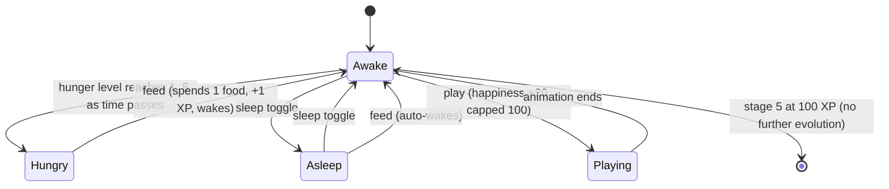
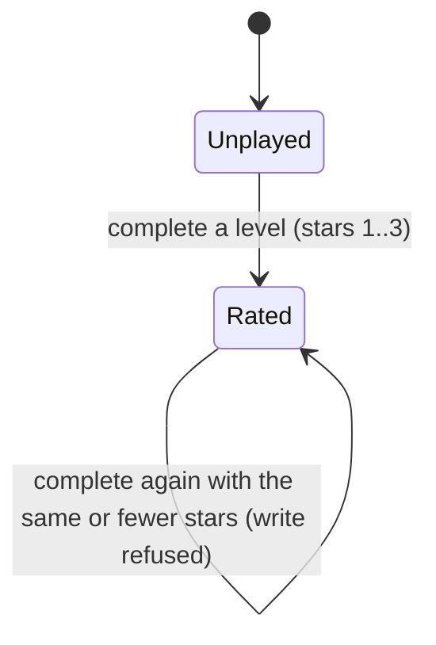

# Workflow state machines

Two entities carry state: the pet, and a level record. Both live in the progress document in the visitor's browser, and
both are advanced only by actions the visitor takes (playing, feeding, resting) plus the passage of time.

## Pet

The pet's observable state is a combination, not a single field: awake or asleep, a hunger level 0–5 derived from how
long ago it was fed, a happiness value 0–100 derived from how long ago it was played with, and an evolution stage 1–5
derived from XP. Only `lastFedAt`, `lastPlayedAt`, `happiness`, `xp`, `stage` and `isSleeping` are stored; everything the
visitor sees is computed from them.

| From | To | Trigger | Who | Guard | Side effects |
|------|----|---------|-----|-------|--------------|
| Awake | Hungry (level 1–5) | time passing | — | `now - lastFedAt >= HUNGER_COOLDOWN × n`; the divisor doubles while asleep; never fed reads 5 | none, it is derived |
| Hungry | Awake | feed | visitor | hungry (`getHungryLevel() >= 1`) **and** `getFoodAvailable() > 0` | `foodConsumed +1`, `xp +1`, `stage` recomputed, `lastFedAt` advanced, `isSleeping` false, event dispatched |
| Awake / Hungry | Asleep | sleep toggle | visitor | none | decay rates remapped so the elapsed time keeps its meaning: hunger divisor doubles, happiness divisor quadruples |
| Asleep | Awake | sleep toggle | visitor | none | decay rates remapped back |
| Asleep | Awake | feed | visitor | same as feed above | the feed wakes the pet (`isSleeping: false`) |
| Awake | Playing | play | visitor | `!isSleeping`; happiness capped at 100 | `happiness` written, `lastPlayedAt` set, event dispatched |
| Playing | Awake | animation completion | — | none | presentation only |
| any stage | next stage | feed | — | `xp` crosses `EVOLUTION_THRESHOLDS` = `0, 10, 30, 60, 100` | `stage` written; on load the stage is always recomputed from XP, so a stale stored stage self-corrects |

Notes that make the table honest:

- Happiness decays because it is derived: `happiness` is the value at the last play, minus 5 per elapsed happiness
  cooldown (`packages/shared/src/progress/service.ts:115-124`). Nothing writes the decay; a UI must re-read
  `getHappiness()` to see it.
- The hunger clock has a floor: a pet that has never been fed (`lastFedAt === 0`) reports the maximum hunger level 5, so
  a first-time visitor can always feed.
- Feeding is the only way to gain XP, and food is only earned by stars, so the correct play loop is
  puzzle → stars → feed → evolution. A feed with no food is a no-op, not an error.

## Level record

A level has three observable states for one visitor on one device. There is no lock state in the data: every level is
reachable, and progress only records achievement.

| From | To | Trigger | Who | Guard | Side effects |
|------|----|---------|-----|-------|--------------|
| Unplayed | Rated | win detected by the game store | visitor | none | `CompletedLevel { module, levelId, completedAt, stars }` appended, document saved, event dispatched |
| Rated | Rated (improved) | win with more stars | visitor | `stars > existing.stars` | record replaced, `completedAt` refreshed, event dispatched |
| Rated | Rated (refused) | win with equal or fewer stars | visitor | `stars <= existing.stars` | nothing written, `completeLevelWithStars` returns `false` |

## Terminal states

The pet has a soft terminal: stage 5 at 100 XP is the last evolution, and further feeding keeps counting XP without
changing the stage. A level record has no terminal state — it can always be improved — and the progress document itself
has none: it is replaced whole on every write and reset by clearing site data.
