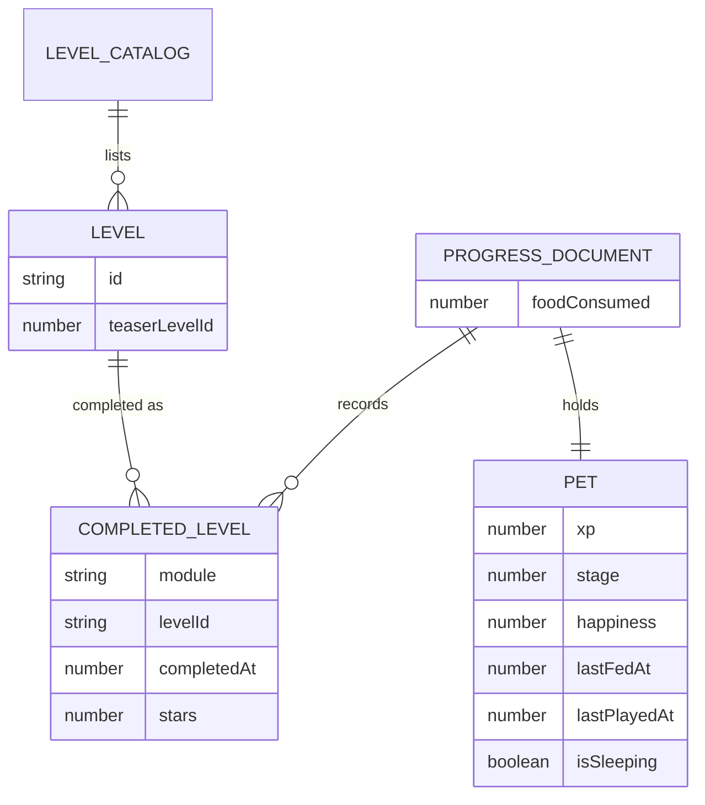

# Data

There is no database. The product stores one document per browser — the visitor's progress — in `localStorage`, and
everything else (prose, posts, level catalogs) is content in the repository that the build turns into static files.

At a glance:

- **A pet that carries the progress.** The visitor's XP, stage, hunger clock and happiness live in one localStorage
  document, written only through the `ProgressRepository` port and read by the shell to render the footer widget.
  Written through `LocalProgressRepository`, never by a component directly.
- **Levels and their stars.** Every finished puzzle writes one record with its module, level id, stars and completion
  time, which is what the devlog's telemetry block summarises.
- **No accounts, no server, no personal data of the visitor.** The document never leaves the browser (ADR-0004), so
  there is nothing to migrate, back up or delete on a server.

## Progress document

One object, versioned by its storage key rather than by an internal field.

| Field | Type | Required | Notes |
|-------|------|----------|-------|
| `completedLevels` | `CompletedLevel[]` | yes | ordered by insertion, newest last; one entry per module and level |
| `foodConsumed` | `number` | yes | stars spent on feeding; the feed allowance is total stars minus this |
| `pet` | `PetState` | yes | the pet's own aggregate |

Persisted under the key `cozyos.progress.v1` in `localStorage` (`packages/shared/src/repository/LocalProgressRepository.ts:5`).
The `.v1` suffix is the whole migration story: an unknown or corrupt document is dropped and rebuilt from the defaults, so
there is no schema version field inside it.

## Entities

### `CompletedLevel`

Definition: `packages/shared/src/progress/types.ts:1-6`. A solved puzzle, as the devlog and the feed allowance count it.

| Field | Type | Nullable | Default | Notes |
|-------|------|----------|---------|-------|
| `module` | `string` | no | — | the package that owns the level: `shikaku`, `sokoban` or `slitherlink` |
| `levelId` | `string` | no | — | the level's id inside that module; module plus id is unique |
| `completedAt` | `number` | no | — | epoch milliseconds of the solve |
| `stars` | `number` | no | `0` | 0–3, the rating the game reported |

Codes: `stars` is a count, not a severity — 0 means solved without a rating, 3 means the best rating. A repeat solve only
replaces the record when the new rating is strictly higher
(`packages/shared/src/repository/LocalProgressRepository.ts:129-131`), so a worse run never costs the visitor stars.

### `PetState`

Definition: `packages/shared/src/progress/types.ts:8-15`. The pet, as one aggregate.

| Field | Type | Nullable | Default | Notes |
|-------|------|----------|---------|-------|
| `xp` | `number` | no | `0` | one per solved level plus one per feed; never decreases |
| `stage` | `number` | no | `1` | 1–5, **derived** from `xp` and re-derived on load |
| `happiness` | `number` | no | `100` | 0–100; decays with idle time, +20 per play, capped |
| `lastFedAt` | `number` | null | `null` | epoch ms of the last feed; `null` means never fed |
| `lastPlayedAt` | `number` | null | `null` | epoch ms of the last play |
| `isSleeping` | `boolean` | no | `false` | set true by the sleep toggle, cleared by any feed |

Codes: `stage` uses a derived enum, not a stored one —
`EVOLUTION_THRESHOLDS = [0, 10, 30, 60, 100]` maps XP to stages 1–5 (`packages/shared/src/pet/evolution.ts:1-8`), and the
repository recomputes it from `xp` on every load (`packages/shared/src/repository/LocalProgressRepository.ts:91-92`) so a
threshold change applies to existing visitors.

### `Level`

Definition: each game's own catalog (`packages/shikaku/src/levels.ts`, `packages/sokoban/src/levels.ts`,
`packages/slitherlink/src/levels.ts`), plus the devlog teaser in content.

| Field | Type | Nullable | Default | Notes |
|-------|------|----------|---------|-------|
| `id` | `string` | no | — | game-scoped, the value written to `CompletedLevel.levelId` |
| `teaserLevelId` | `string` | no | — | which level a devlog post shows as its teaser (`content/devlog.ts`), immutable once a post ships |

There is no `level` table anywhere: a level exists because a build imported it, and a completed level exists because the
visitor solved it. Nothing validates that a `CompletedLevel.levelId` still exists in the catalog — a removed level leaves
its record behind, and the feed allowance still counts its stars.

### Posts and content

Posts are markdown files in `public/posts/` compiled to typed objects at build time (ADR-0006); the `devlog` content
module holds the post list, the hat's copy and the telemetry teaser config. Neither is stored, keyed or indexed — they are
build inputs, and their shape is fixed by `docs/02-reference/conventions` and the content module's types.

## Access rules

- Only `ProgressRepository` reads or writes the document
  (`packages/shared/src/repository/ProgressRepository.ts:3-12`): `getState`, `completeLevel`, `completeLevelWithStars`,
  `feedPet`, `playWithPet`, `toggleSleep`, `saveState`, `dispose`. A component that calls `localStorage` directly is a
  defect.
- The shell owns the single instance and injects it; game packages receive behaviour, never storage. This is why a game
  can be dropped for its own release cycle without knowing where progress lives.
- One document per origin, so progress is per browser profile and per host: localhost, a preview and production are three
  separate pets. Two tabs of the same origin stay in sync through the `storage` event
  (`packages/shared/src/repository/LocalProgressRepository.ts:36`).
- Nothing is transmitted: no request carries pet or progress data, and no analytics event exists to carry it (NFR-10).

## Retention

Progress lives until the visitor clears site data; the pet is meant to be lost that way. There is no deletion API, no
export and no server copy — all three were deleted with the cloud adaptor (ADR-0004), and their absence is a promise, not
an omission. Build outputs (posts, teaser levels, telemetry) are regenerated from the repository on every build and have
no retention of their own.
